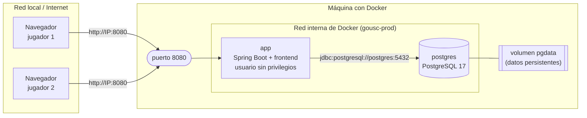
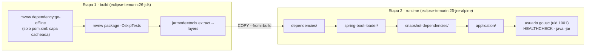

# GoUSC — Guía de despliegue (Fase 6)

Cómo poner GoUSC en marcha con Docker en cualquier máquina para que otras personas
jueguen desde su navegador, sin instalar Java ni PostgreSQL.

> Otros documentos: [README](../README.md) · [Guía técnica del backend](backend.md) ·
> [Base de datos](database.md)

## Índice

1. [Qué se despliega](#1-qué-se-despliega)
2. [Desplegar en 3 pasos](#2-desplegar-en-3-pasos)
3. [Conectarse desde otra máquina](#3-conectarse-desde-otra-máquina)
4. [Configuración](#4-configuración)
5. [Operaciones habituales](#5-operaciones-habituales)
6. [Cómo está hecha la imagen](#6-cómo-está-hecha-la-imagen)
7. [Desarrollo frente a despliegue](#7-desarrollo-frente-a-despliegue)
8. [Solución de problemas](#8-solución-de-problemas)

---

## 1. Qué se despliega

Dos contenedores definidos en [`compose.prod.yaml`](../compose.prod.yaml):



- **app**: la imagen `gousc` construida con el [`Dockerfile`](../Dockerfile). Sirve a la vez
  la API REST y el frontend (`static/`), así que el navegador habla siempre con el mismo
  servidor y no hace falta configurar CORS ni la URL de la API.
- **postgres**: la base de datos. **No publica ningún puerto**: solo `app` puede hablar con
  ella a través de la red interna de Docker.
- **pgdata**: volumen donde PostgreSQL guarda los datos. Sobrevive a reinicios,
  actualizaciones y a `docker compose down`.

Al arrancar, la aplicación crea las tablas (JPA) y siembra los usuarios de prueba
(`deivi`, `ana`, `joel`, `pepe`) si aún no existen.

---

## 2. Desplegar en 3 pasos

Requisito único: **Docker** con el plugin **Compose** (`docker compose version`).

```bash
# 1. Descargar el proyecto
git clone https://github.com/figurophobia/GoUSC.git
cd GoUSC

# 2. (Opcional) Configurar puerto y contraseña de la base de datos
cp .env.example .env      # y edita .env

# 3. Construir la imagen y arrancar todo
docker compose -f compose.prod.yaml up -d --build
```

La primera vez tarda unos minutos (descarga las imágenes base y las dependencias de
Maven); las siguientes, segundos. Para comprobar que está listo:

```bash
docker compose -f compose.prod.yaml ps
```

```
NAME                    STATUS                    PORTS
gousc-prod-app-1        Up 20 seconds (healthy)   0.0.0.0:8080->8080/tcp
gousc-prod-postgres-1   Up 31 seconds (healthy)   5432/tcp
```

Cuando `app` aparece como **`healthy`**, abre **http://localhost:8080** en esa máquina.

---

## 3. Conectarse desde otra máquina

1. **Averigua la IP de la máquina** donde corre Docker:

   ```bash
   hostname -I        # Linux  (p. ej. 192.168.1.236)
   ipconfig           # Windows (dirección IPv4)
   ```

2. Desde cualquier otro ordenador o móvil **de la misma red** abre
   `http://<esa-IP>:8080`, por ejemplo `http://192.168.1.236:8080`.

3. Si no carga, revisa el **cortafuegos** de la máquina servidora:

   | Sistema | Qué hacer |
   |---------|-----------|
   | Fedora Workstation | Nada: la zona por defecto ya permite los puertos 1025–65535. |
   | Fedora/RHEL servidor (`firewalld`, zona `public`) | `sudo firewall-cmd --add-port=8080/tcp --permanent && sudo firewall-cmd --reload` |
   | Ubuntu con `ufw` | `sudo ufw allow 8080/tcp` |
   | Windows / macOS (Docker Desktop) | Acepta el aviso del cortafuegos la primera vez, o permite el puerto 8080. |

**Fuera de la red local** (amigos en otra casa), la máquina necesita ser accesible desde
Internet: un servidor o VPS con IP pública, abrir el puerto en el router, o una VPN de
malla tipo Tailscale/ZeroTier en la que todos estén conectados.

> **Seguridad.** El proyecto identifica a los usuarios con la cabecera `X-User-Id` y
> guarda las contraseñas en texto plano (decisiones de clase, ver
> [backend.md §6](backend.md#6-decisiones-técnicas)). Está bien para una red de confianza
> o una demo; **no lo expongas a Internet abierto** sin añadir antes autenticación real
> (JWT) y HTTPS.

---

## 4. Configuración

Todo se configura con variables en un fichero **`.env`** junto a `compose.prod.yaml`
(plantilla: [`.env.example`](../.env.example)). Si no existe `.env`, se usan los valores
por defecto.

| Variable | Por defecto | Para qué sirve |
|----------|-------------|----------------|
| `GOUSC_PORT` | `8080` | Puerto de la máquina por el que se entra a la web. |
| `POSTGRES_DB` | `gousc` | Nombre de la base de datos. |
| `POSTGRES_USER` | `gousc` | Usuario de la base de datos. |
| `POSTGRES_PASSWORD` | `gousc` | Contraseña de la base de datos. **Cámbiala** en un servidor compartido. |
| `JAVA_OPTS` | `-XX:MaxRAMPercentage=75` | Opciones de la JVM (memoria, etc.). |

Cómo llegan a la aplicación: `compose.prod.yaml` las convierte en
`SPRING_DATASOURCE_URL/USERNAME/PASSWORD`, que Spring Boot usa en lugar de los valores de
`application.properties` (que apuntan a `localhost` para desarrollo). No hay que tocar
código ni recompilar para cambiar de base de datos.

> PostgreSQL solo aplica `POSTGRES_DB/USER/PASSWORD` **al crear la base de datos** (primer
> arranque con el volumen vacío). Si los cambias después, o bien borras los datos
> (`down -v`, ver abajo) o cambias la contraseña dentro de PostgreSQL.

---

## 5. Operaciones habituales

Todas se lanzan desde la carpeta del proyecto. Para no repetir `-f compose.prod.yaml`
puedes definir un alias: `alias gousc='docker compose -f compose.prod.yaml'`.

| Tarea | Comando |
|-------|---------|
| Ver el estado | `docker compose -f compose.prod.yaml ps` |
| Ver los logs de la aplicación | `docker compose -f compose.prod.yaml logs -f app` |
| Parar (conserva los datos) | `docker compose -f compose.prod.yaml down` |
| Volver a arrancar | `docker compose -f compose.prod.yaml up -d` |
| Actualizar a la última versión | `git pull && docker compose -f compose.prod.yaml up -d --build` |
| Copia de seguridad | `docker compose -f compose.prod.yaml exec -T postgres pg_dump -U gousc gousc > backup.sql` |
| Restaurar una copia | `docker compose -f compose.prod.yaml exec -T postgres psql -U gousc gousc < backup.sql` |
| Abrir una consola SQL | `docker compose -f compose.prod.yaml exec postgres psql -U gousc gousc` |
| **Borrar todo, datos incluidos** | `docker compose -f compose.prod.yaml down -v` |

Los contenedores tienen `restart: unless-stopped`: si la máquina se reinicia, GoUSC vuelve
a arrancar solo (salvo que lo hayas parado tú con `down`).

---

## 6. Cómo está hecha la imagen

El [`Dockerfile`](../Dockerfile) tiene **dos etapas**:



| Decisión | Motivo |
|----------|--------|
| **Multi-etapa** | El JDK y Maven solo se usan para compilar. La imagen final lleva únicamente el JRE y el jar. |
| **JRE Alpine** | La imagen final ocupa ≈ 414 MB, frente a 590 MB con el JRE sobre Ubuntu, e incluye `wget` para el healthcheck. |
| **Dependencias antes que el código** | `dependency:go-offline` se ejecuta solo con el `pom.xml`: si cambias código pero no dependencias, Docker reutiliza esa capa. Además, `--mount=type=cache` guarda `~/.m2` entre builds. |
| **Jar extraído por capas** | Las librerías (50 MB) van en una capa y el código propio (≈ 120 KB) en otra: una versión nueva solo cambia la capa pequeña. |
| **Tests fuera del build** | Los tests necesitan PostgreSQL; se ejecutan con `./mvnw test` antes de desplegar, no dentro de Docker. |
| **Usuario sin privilegios** | El proceso Java corre como `gousc` (uid 1001), no como root. |
| **`HEALTHCHECK`** | Docker comprueba cada 15 s que `GET /users/ranking` responde; así `ps` muestra `healthy` y se detecta si la app se cuelga. |
| **`MaxRAMPercentage=75`** | La JVM ajusta su memoria al límite del contenedor en lugar de a la RAM total de la máquina. |
| **Sin DevTools ni Docker Compose en el jar** | `spring-boot-maven-plugin` los excluye del jar final: son solo de desarrollo. |

Para construir solo la imagen (sin arrancar nada): `docker build -t gousc .`

---

## 7. Desarrollo frente a despliegue

El proyecto tiene **dos ficheros Compose** con propósitos distintos:

| | `compose.yaml` (desarrollo) | `compose.prod.yaml` (despliegue) |
|--|-----------------------------|----------------------------------|
| Qué arranca | Solo PostgreSQL | PostgreSQL + la aplicación |
| Quién lo usa | Spring Boot automáticamente al hacer `./mvnw spring-boot:run` (módulo `spring-boot-docker-compose`) | Tú, con `docker compose -f compose.prod.yaml ...` |
| La aplicación corre en | Tu JDK local (con recarga de DevTools) | Un contenedor |
| Puerto de PostgreSQL | Publicado en `localhost:5432` (para el IDE y los tests) | No publicado |
| Datos | Volumen `gousc_gousc-pgdata` | Volumen `gousc-prod_pgdata` |

Son **independientes**: tienen nombres de proyecto distintos (`gousc` y `gousc-prod`) y
cada uno su volumen, así que la base de datos de desarrollo y la desplegada no se mezclan.
Solo hay que evitar usar el puerto 8080 con los dos a la vez (o cambiar `GOUSC_PORT`).

---

## 8. Solución de problemas

| Síntoma | Causa probable y solución |
|---------|---------------------------|
| `Bind for 0.0.0.0:8080 failed: port is already allocated` | Otro programa usa el 8080 (p. ej. `./mvnw spring-boot:run`). Páralo o pon `GOUSC_PORT=8081` en `.env`. |
| `app` se queda en `starting` o pasa a `unhealthy` | Mira `docker compose -f compose.prod.yaml logs app`. Lo habitual es un error de conexión a la base de datos (contraseña cambiada después de crear el volumen: ver §4). |
| `password authentication failed for user "gousc"` | Cambiaste `POSTGRES_PASSWORD` con el volumen ya creado. Pon la contraseña original o empieza de cero con `down -v`. |
| Desde otra máquina no carga | Comprueba la IP (`hostname -I`), que ambas máquinas están en la misma red y el cortafuegos (§3). Desde la propia máquina, `curl http://localhost:8080/users/ranking` debe responder. |
| Cambié código y no se ve | Hay que reconstruir: `docker compose -f compose.prod.yaml up -d --build`. En el navegador, recarga forzada (Ctrl+Shift+R). |
| Quiero empezar con la base de datos vacía | `docker compose -f compose.prod.yaml down -v` y vuelve a hacer `up -d`. |

---

Volver al [README](../README.md) · [Guía técnica del backend](backend.md).
